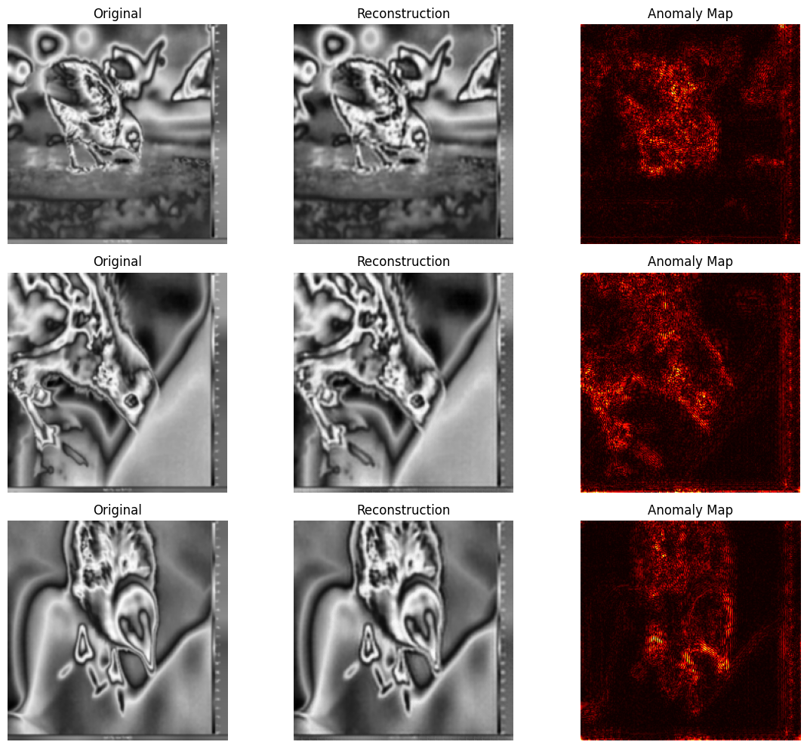
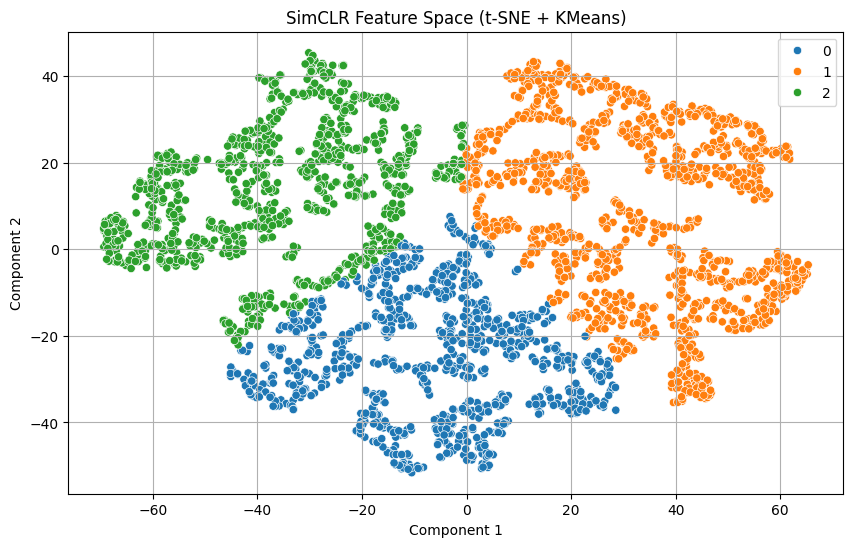

# Thermal Stress Detection in Farm Chicks Using Self-Supervised Learning and Thermal Imaging

## Project Overview

This repository is an exploratory proof-of-concept that applies **self-supervised representation learning** and **unsupervised anomaly detection** to thermal videos of laying hen chicks. The aim was to test whether frame-level thermal patterns can be learned without manual labels, as a first step towards non-invasive stress monitoring in poultry.

All code is in a single Google Colab notebook: [`Thermal_Hens _New.ipynb`](Thermal_Hens%20_New.ipynb).

---

## Example Outputs

**Autoencoder anomaly maps** (frames with the highest reconstruction error; generated by the notebook):

**SimCLR embeddings** (t-SNE with K-means, k = 3; generated by the notebook):

Additional figures:

---

## Research Questions

1. Can thermal fluctuation patterns in chicks be represented meaningfully without manual labels?
2. Can a reconstruction-based model flag frames that deviate from typical thermal patterns?
3. What would be needed to link these flagged frames to actual stress states?

---

## Dataset

The thermal videos come from a public Kaggle dataset. They were **not** recorded by me.

* **Dataset:** [Uncovering the Hidden Language of Chick Welfare](https://www.kaggle.com/datasets/sureshneethirajan/thermalvideoslayinghens) (Kaggle, uploaded by Suresh Neethirajan)
* **Licence:** CC BY-NC 4.0 (attribution required, non-commercial use only)
* **Original study:** Pijpers, N., van den Heuvel, H., Duncan, I. H., Yorzinski, J., and Neethirajan, S. (2022). *Understanding Chicks' Emotions: Are Eye Blinks & Facial Temperatures Reliable Indicators?* bioRxiv 2022.01.31.478468. https://doi.org/10.1101/2022.01.31.478468
* **Content:** thermal videos of laying hen chicks recorded before and after exposure to a stressor (see the original study for the protocol)
* **Used here:** frames were extracted from the videos without the before/after stressor labels, so the analysis is fully unsupervised

The videos are not redistributed in this repository. Please download them from Kaggle and cite the original study if you use them.

---

## Method (as implemented in the notebook)

### 1. Frame extraction and preprocessing
* Every 6th frame extracted (about 5 fps from 30 fps video), giving **3,103 frames**
* Frames resized to 224 x 224 and converted to grayscale
* CLAHE contrast enhancement (clip limit 2.0, 8 x 8 tiles) and 3 x 3 Gaussian blur

### 2. Frame quality checks
* Visual inspection of random frames and intensity histograms
* Automatic low-contrast check (standard deviation below 15): no frames flagged
* Mean brightness plotted over the frame sequence to check for flicker or exposure changes

### 3. Self-supervised representation learning (SimCLR)
* ResNet-18 encoder (trained from scratch) with a 2-layer projection head (512 to 128)
* Augmentations: random resized crop, horizontal flip, colour jitter, random grayscale
* NT-Xent contrastive loss (temperature 0.5), batch size 32, Adam (lr 1e-3), 10 epochs
* Average loss decreased from 4.11 to 3.45 over 10 epochs

### 4. Embedding visualisation
* t-SNE (perplexity 30) on the learned embeddings
* K-means (k = 3) on the t-SNE output to show possible groupings

### 5. Anomaly detection with a convolutional autoencoder
* 2D convolutional autoencoder (3 strided conv layers, 3 transposed conv layers, sigmoid output)
* Trained with MSE reconstruction loss, Adam (lr 1e-3), batch size 16, 25 epochs
* Per-frame reconstruction error used as an anomaly score
* Frames with the highest error shown with original, reconstruction and difference map
* Difference maps rendered as colour overlays and combined into an overlay video

---

## What This Project Shows, and What It Does Not

**Shows**
* A complete, runnable pipeline from raw thermal video to self-supervised embeddings and per-frame anomaly scores
* Contrastive training and autoencoder reconstruction both converge on this data

**Does not yet show**
* That high-error frames correspond to stress. No labels were used, so no accuracy or precision can be reported.
* That the K-means groups are meaningful. Clustering was done on t-SNE output, which is useful for visualisation but not for reliable clustering.
* Generalisation. The autoencoder was trained and scored on the same frames, with no held-out set.
* That anomaly maps reflect the animal only. The anomaly maps also highlight the on-screen temperature scale bar and frame borders, so these should be masked out before interpreting results.

---

## Planned Next Steps

The following were part of the original project plan but are **not yet implemented** in this notebook:

* **Grad-CAM explainability.** Grad-CAM needs a classifier, so the plan is to first train a classifier using the before/after stressor labels, then apply Grad-CAM to see which regions drive the prediction
* **Farneback optical flow** to capture movement patterns alongside temperature
* **3D convolutional autoencoder** to model short frame sequences instead of single frames
* **DBSCAN** to separate outlier frames from the main clusters
* **GAN-based reconstruction** as an alternative anomaly detector

Other next steps:

* Use the **before/after stressor** structure of the original study as weak labels, and test whether anomaly scores are higher after the stressor
* Split data by video (not by frame) to avoid leakage between training and evaluation
* Work with radiometric temperature values rather than image intensity
* Add region-of-interest analysis (eye, head, beak) to match the regions reported in the original study

---

## Tools

| Step | Tools |
| --- | --- |
| Frame extraction and preprocessing | Python, OpenCV, NumPy |
| Visualisation | Matplotlib, Seaborn, imageio |
| Self-supervised learning and autoencoder | PyTorch, torchvision |
| Dimensionality reduction and clustering | scikit-learn (t-SNE, K-means) |

---

## How to Run

1. Download the videos from the Kaggle dataset above.
2. Open the notebook in Google Colab and set `video_dir` to the folder containing the videos.
3. Install dependencies if running locally: `pip install -r requirements.txt`
4. Run the cells in order. A GPU is recommended for the SimCLR and autoencoder steps.

---

## Citation and Credit

If you use the data, please cite Pijpers et al. (2022) as listed above. This repository contains only my analysis code.
